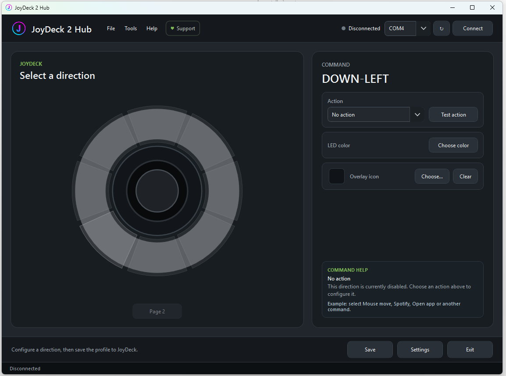
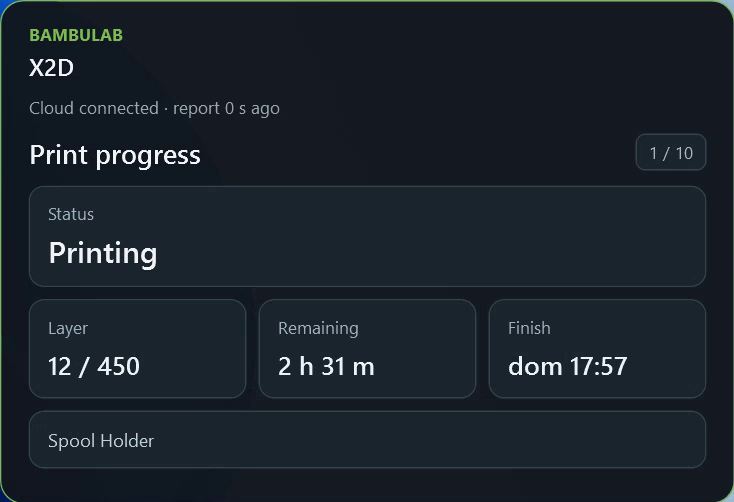

# JoyDeck 2 Hub

**Your desktop, one joystick away.**

Turn an eight-way joystick into a programmable controller for applications, shortcuts, media, CAD workflows and Bambu Lab printer monitoring.

[Get started on MakerWorld](https://makerworld.com/en/models/3316603) · [Software updates](https://github.com/DGVeLab/JoyDeck2/releases/latest) · [User guide](Docs/README.md) · [Italiano](README.it.md)

JoyDeck 2 combines an ESP32-based controller with a Windows application. Assign actions to the eight joystick directions, choose their LED colors and overlay icons, then control your desktop without reaching for the keyboard.

## What you can do

| Feature | What it does |
|---|---|
| Application launcher | Open programs, files and links. |
| Keyboard shortcuts | Run presets or custom combinations and macros; hold a key or repeat it at a chosen interval. |
| Mouse move | Move the pointer with configurable joystick-button actions. |
| Orbital | Navigate CAD and 3D views using pointer movement and a held mouse button. |
| Media and Spotify | Adjust volume, change tracks and toggle playback. |
| System Control | Call Windows actions such as volume control or session locking. |
| HTTP Request | Trigger a webhook, network service or compatible smart device. |
| Page 2 | Open a temporary second set of eight directions. |
| Mini Game | Play Memory or Reaction with RGB feedback and saved high scores. |
| BambuLab | View printer progress, temperatures, fans and status through Bambu Cloud. |

## Make it yours

- Choose a separate RGB color and overlay icon for each direction, including custom images.
- Select a global trigger: **On release**, **On confirm** or **Hold**.
- Adjust dead zone, mouse sensitivity and LED brightness.
- Test an action before saving it.
- Export and import configuration packages, including Page 2 and custom icons.

**Page 2:** one direction on Page 1 opens eight additional slots. The controller returns to Page 1 after an action or timeout. With one slot used to open Page 2, you can assign up to **15 action slots** across both pages.

**Mouse move and Orbital:** choose one instance of either mode across both pages. They cannot be assigned together.

## Bambu Lab monitoring

Assign **BambuLab** to a direction, sign in through **Cloud settings** and select a printer. Different directions can select different printers; one monitor is active at a time.

- View print progress, layers and estimated remaining time.
- Follow nozzle, bed and chamber temperatures with live graphs where available.
- Inspect fan speeds, printer status and reported HMS errors.
- Navigate with the joystick, cycle views with a click and exit with a long press.
- Keep the monitor window where you want it; its position is remembered.

The PC must remain on, JoyDeck 2 Hub must be running and the printer must be available through Bambu Cloud. Available readings depend on the printer and its cloud reports. Initial data can take time to arrive; rapid reopening may require waiting up to about five minutes for a complete report.

This is a monitoring feature: it does not start or stop prints, move the printer, or change heating, speed or fan settings. It uses Bambu Cloud rather than a local LAN connection.

The Bambu access token stays on your PC, protected for the current Windows user. It is excluded from configuration backups. Sign in again if the cloud session expires. See the [Privacy Notice](PRIVACY.txt).

## Requirements

- Windows 10 or 11, 64-bit x64.
- Compatible JoyDeck hardware with firmware supporting JoyDeck 2 Hub.
- USB data cable and the USB-to-serial driver required by your board.
- Internet access for activation requests, update checks and online features. Bambu monitoring also requires a Bambu Lab account with an available cloud printer.

Use the firmware identified as compatible in the JoyDeck 2 release instructions. A firmware image intended for an older Hub is not automatically compatible with JD2.

## First setup

1. Start from the [MakerWorld project](https://makerworld.com/en/models/3316603) for the build files, assembly information and first-download instructions.
2. Install the release package for Windows. Download the installer attached to the release; GitHub's **Source code** archives are not Windows installers.
3. Complete the free activation procedure when prompted.
4. Install compatible firmware if needed, following the release instructions. The [DGVeLab Flash Center](https://dgvelab.github.io/DGVeLab-Flash-Center/) and [ESP-Programmer resources](https://github.com/DGVeLab/ESP-Programmer) provide flashing tools and driver information. Select a firmware specifically identified for your device and JD2.
5. Close flashing tools or serial monitors, reconnect USB if necessary, then open JoyDeck 2 Hub.
6. Select the correct COM port and click **Connect**. Leave the stick centered during calibration.
7. Select a direction, choose its action, set the parameters, color and icon, then use **Test action** and **Save**.

See [Installation](Docs/INSTALLATION.md) and the [illustrated Italian manual](Docs/JoyDeck_2_Manuale_Uso_IT_rev8_Illustrato.docx) for more detail.

## Free activation

**JoyDeck 2 Hub is free to use.** If activation is requested, submit your details through the application's activation form and enter the code supplied by DGVeLab. Allow time for the request to be processed; submitting it does not immediately activate the software.

If an existing activation is accepted, no new request is needed. When moving from JD1, follow the result shown by JD2 rather than assuming that an old activation or firmware will work unchanged.

## Updating and moving from JD1

JoyDeck 2 Hub is the successor to the original JoyDeck Hub. This repository hosts the JD2 software distribution and documentation; the [original JoyDeck repository](https://github.com/DGVeLab/JoyDeck) remains separate.

Export your current configuration before upgrading. Close JD1 before connecting JD2 to the same serial port. Use the firmware required by the JD2 release and check imported assignments before use. Older profiles without Page 2 load with an empty second page; the [migration guide](Docs/MIGRATION_FROM_JD1.md) explains the remaining checks.

Subsequent releases are available from [Releases](https://github.com/DGVeLab/JoyDeck2/releases). The application also provides **Check for updates**.

## Help and feedback

Start with [Troubleshooting](Docs/TROUBLESHOOTING.md). For a reproducible problem, [open an issue](https://github.com/DGVeLab/JoyDeck2/issues) with the Hub version, firmware version and steps to reproduce it. Remove account details, tokens and private URLs from attachments.

Support and activation enquiries: **dgvelab@gmail.com**.

## Project and license

Created by **Ernesto Sorrentino · DGVeLab** — electronics, firmware, software and 3D printing.

JoyDeck is an independent maker project. The Bambu Lab integration is not an official Bambu Lab product and is not affiliated with or endorsed by Bambu Lab. Spotify and other product names belong to their respective owners.

The application is distributed under the [JoyDeck 2 Hub end-user license](LICENSE.txt). Free use does not grant ownership of the software or its assets. This repository provides distribution resources and documentation; it does not offer the application source under an open-source license. Third-party components retain their own licenses; see [Third-party notices](THIRD_PARTY_NOTICES.md).
